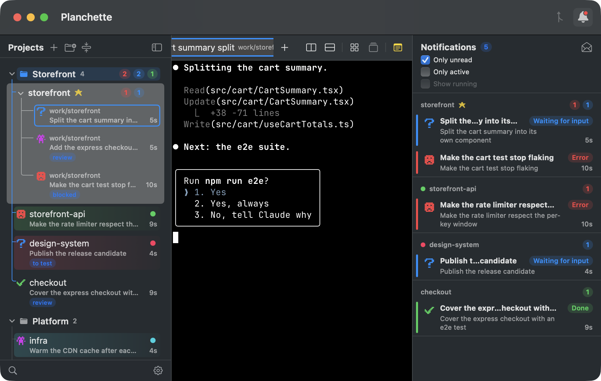
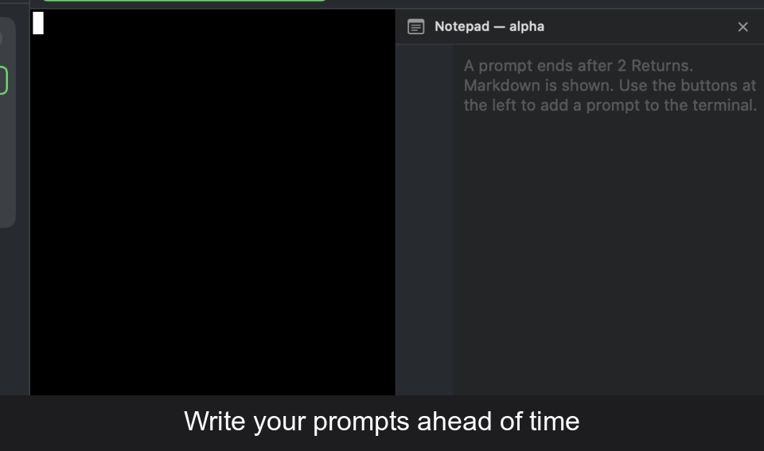
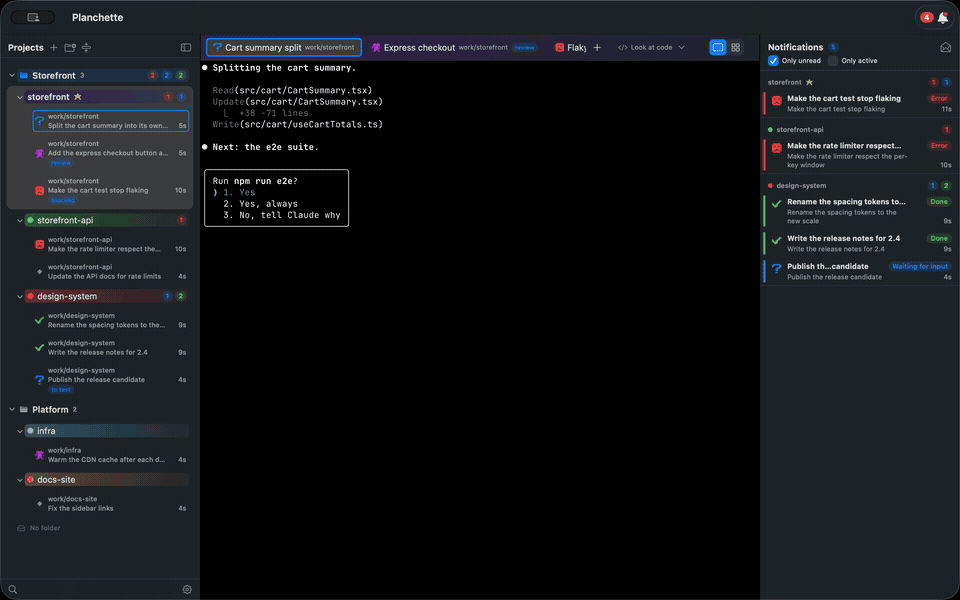
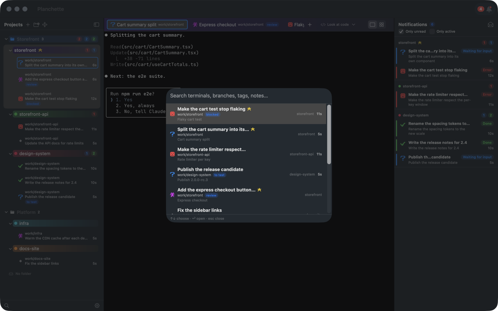
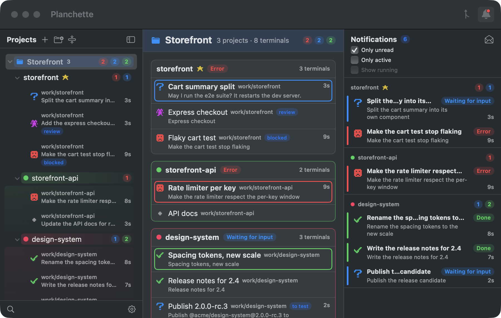
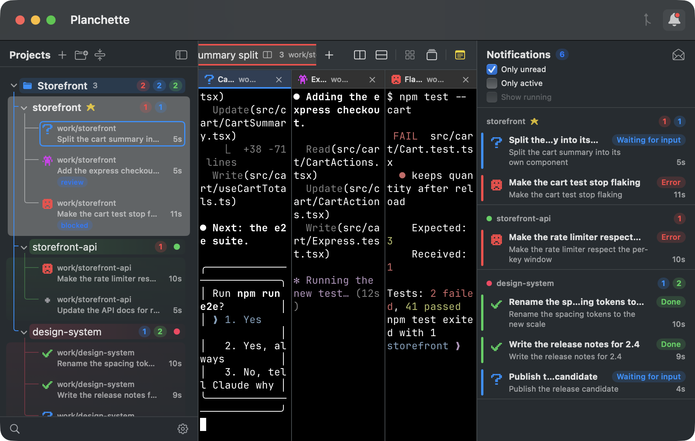
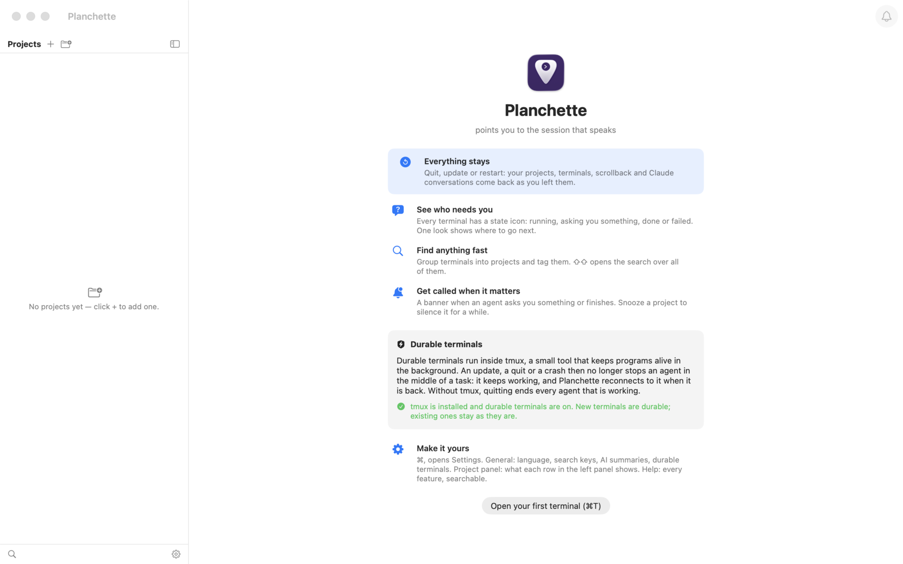
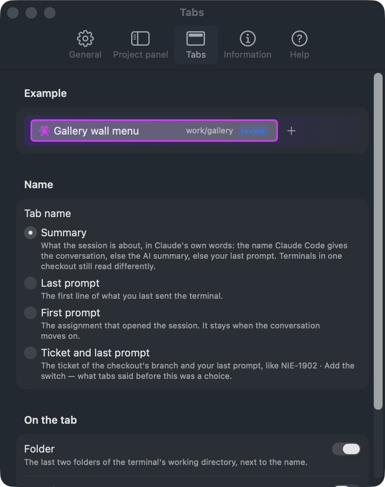
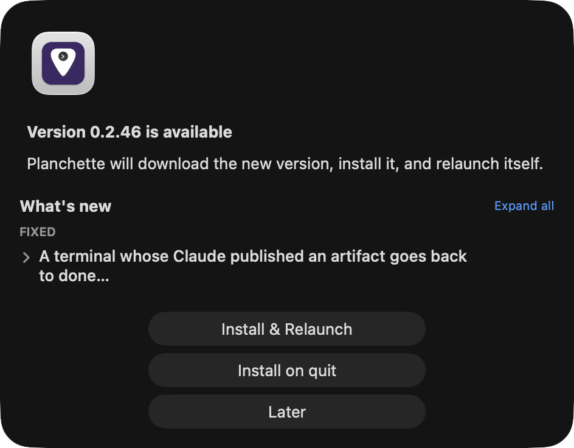

<p align="center">
  
</p>

<h1 align="center">Planchette</h1>

<p align="center">
  <b>Run many AI coding agents at once and always know which one needs you.</b>
</p>

<p align="center">
  A native macOS terminal built on <a href="https://ghostty.org">Ghostty</a> (libghostty).<br>
  Terminals are grouped into projects, projects into folders, and every terminal carries a state:
  <b>running · waiting · error · done · free</b>.
</p>

<p align="center">
  
</p>

> **Two things set Planchette apart:** [everything stays](#everything-stays) — quit, update or crash,
> and the next launch puts every session back — and [the notepad](#the-notepad) — prompts written
> ahead, sent with one click.

## Everything stays

**This is the feature the rest is built around: whatever happens to the app or the Mac, the next
launch puts your work back.** Every project and folder; every terminal in its working directory,
with what it had printed and the line you were halfway through typing; every Claude conversation,
resumed where it stopped; your tags, colors, notes, window layout and settings. One dialog at
launch — *Restore* or *Start fresh* — and a fresh start archives the old workspace
(`state-previous.json`) instead of deleting it. Saved arrangements are never touched.

| | Quit, update (*Install & Relaunch*), crash | Reboot or logout |
|---|---|---|
| Projects, folders, tabs and their splits, windows, tags, colors, notes, settings | kept | kept |
| What each terminal printed, and the line you were typing at its prompt | kept | kept |
| A Claude conversation | resumed with `claude --resume` — in a durable terminal it never stopped | resumed with `claude --resume` |
| A dev server or other startup command | started again — in a durable terminal it never stopped | started again |

No terminal app can keep a process alive through a reboot. What *can* survive an update or a crash
is a running agent, and that is what [durable terminals](#setup--what-unlocks-what) are for: with
tmux installed the agent keeps working while Planchette is gone, and reopening re-attaches to the
**live** session instead of resuming a conversation. Planchette offers them on the first launch,
and once after each update until you have them.

## The notepad

**Prompts, ready to send.** Every terminal has a notepad at the right of its tab (⌘J), saved with the
workspace. Write the next prompts while the agent works; send each one with a click.

<p align="center">
  
</p>

- **Two buttons per prompt.** The down arrow adds it to the terminal as a draft, the return arrow
  adds it and presses Return. ⌘↩ in a prompt does the same as the return arrow.
- **Markdown as you type** — headlines, lists, quotes, code, bold, italic — sized to the width of the
  pad. The text stays as typed, so what reaches the terminal is what you wrote.
- **A prompt is a block** that ends at a blank line (one to three Returns, a setting), and a code
  fence is one prompt. A prompt that was sent leaves the pad, or is struck through (Settings → Tabs).

## See it work

<p align="center">
  
</p>

<p align="center"><sub>Recorded from the app itself. A question arrives in another project; search
(⇧⇧) finds it and Enter jumps there; ⌘F finds text in the terminal, every match highlighted.</sub></p>

## Install

macOS 14+, Apple Silicon or Intel.

```sh
curl -fsSL https://raw.githubusercontent.com/marcello-a/Planchette/main/scripts/install.sh | sh
```

Verifies the download against the release's `SHA256SUMS`, installs to
`/Applications`, clears the quarantine flag. ~70 lines, read it first if you like:
[`scripts/install.sh`](scripts/install.sh).

```sh
sh install.sh 0.2.18                          # pin a version
PLANCHETTE_DEST=~/Applications sh install.sh  # install elsewhere
```

Or grab `Planchette.dmg` from the [latest release](https://github.com/marcello-a/Planchette/releases/latest).
Updates come in-app afterwards (**Install & Relaunch**, or staged until you quit).

<details>
<summary><b>"Apple could not verify Planchette is free of malware"</b></summary>

Expected — the app is ad-hoc signed, not notarized (that needs a paid Developer
ID). The install script above clears the flag for you. By hand:

```sh
xattr -dr com.apple.quarantine /Applications/Planchette.app
```

Or *System Settings → Privacy & Security → Open Anyway* after the first blocked
launch. On macOS 14, right-click the app → *Open*.
</details>

## Setup — what unlocks what

Planchette works out of the box. Its best features switch on the moment their
one prerequisite exists — nothing to configure:

| You have | You get |
|---|---|
| **tmux** — `brew install tmux` | **Durable terminals.** Agents survive quit, crash and *Install & Relaunch*: the shell runs in a private tmux server that outlives the app, and reopening re-attaches to the **live** session — the turn keeps running — instead of merely resuming a conversation. On by default as soon as tmux is found. ⌘F searches tmux's history for them. |
| **Claude Code** | **Live states with zero setup.** Planchette installs its hooks into `~/.claude/settings.json` on first launch. Every color in the sidebar — running, waiting, error, done — comes straight from the agent. Tabs take their names from Claude's own name for the conversation. |
| **Codex** | Recognized too: a hook claims the terminal (auto-installed into `~/.codex/hooks.json` when `~/.codex` exists), and screen detection reads the states off its TUI. |
| **`claude` on your PATH** | **AI summaries** — one line per terminal saying what it is actually doing, via headless `claude -p` on your existing login. On by default; toggle in Settings → AI. |
| **`gh`** (GitHub CLI) | **Pull request pills.** The PR of each terminal's branch and its review state, on its row; click it to open the PR. **Reviews:** the PRs that ask for your review, in the right panel (icon left of the bell). |

Also worth a second:

- **Allow notifications** when macOS asks — clicking a banner jumps straight to
  the terminal that needs you, even relaunching the app if it has to.
- Durable terminals have exactly one trade-off: tmux cannot pass the terminal's
  keyboard protocol through, so **Shift+Enter reaches an agent as a plain
  Enter**. If multi-line prompts matter more to you than agents that outlive the
  app, turn it off in *Settings → Durable terminals*. It applies to terminals
  created from then on; existing ones keep what they were created as. A reboot
  still ends everything — tmux's server dies with the machine.

## What it does

### Know who needs you

- Every terminal shows what it is doing: **running · waiting · error · done · free**. The states
  come from agent hooks, with a screen fallback every 1.5 s when the hooks stay silent — rules in
  editable JSON.
- A finished or interrupted command ends its state: the "?" of a `brew install` question goes
  when the command does.
- Notifications panel: "Needs you" first, errors before questions, oldest first; read and unread,
  menu-bar and dock badges, and ⌘⇧K jumps to the most urgent waiting terminal.
- **Reviews** (the icon left of the bell, needs `gh`): the pull requests that ask for your review,
  in the same panel. Start one in a checkout nobody works in, or in a temporary worktree that goes
  afterwards; the `review-pr` Claude Code skill reviews it (yours, or Planchette's default from
  [`skills/review-pr`](skills/review-pr/SKILL.md)); you decide per finding — Comment, Fix or
  Skip, preselected — and nothing reaches GitHub before "Send review".
- Snooze a terminal or a project (1 h / 2 h / tomorrow 9:00) with a reminder when it ends, or park
  a project you are not working on.
- Background agents and shells show under the state icon, and the terminal stays purple (running,
  with a globe in place of the robot) while they work, so a terminal that looks idle but still
  works says so. Optional per terminal:
  context ring, model, prompt-cache timer, and the pull request with its review state.

### Find your way

<p align="center">
  
</p>

- **Search from anywhere with ⇧⇧** (or ⌘K; change the keys in Settings). Words in any order across
  title, path, project, branch, tags, notes, summary, last message and pull request; `#2093`
  jumps to a ticket or PR number; matched letters are bold and a line says where each hit was found.
- **Find in a terminal with ⌘F.** Every match is highlighted and counted, Enter steps through them.
  For a durable terminal the search runs in tmux, which keeps its history.
- **Tabs are named after what the session is about** — Claude's own name for the conversation,
  else the AI summary, else your last prompt — not after the branch. *Settings → Tabs* changes what
  names a tab and what else it shows (folder, branch, tags). The tab bar scrolls with a swipe or
  the mouse wheel, and the **+** stays in reach.
- **Each project wears its color** — the tab bar, the project panel, the overview — as a gradient
  in the color you pick; a project without a color stays plain. *Settings → General → Project
  color* turns it off, keeps it on the label, or makes it colorful, subtle (the default) or faint.

### Organise work

<p align="center">
  
</p>

- Projects in folders; drag one into a folder and drop it into an exact slot. Click a folder for an
  overview: every project, its state, its terminals.
- Tabs that split, as in iTerm2: drag a tab onto a terminal's edge to split it, a pane's title back onto the tab bar to make it a tab; ⌘D / ⌘⇧D split off a new terminal; one button puts every tab in one view.
- Tags (with a list you edit), colors, favorites, notes; multi-select (⌘/⇧-click)
  for batch actions.
- Choose what every row of the project panel shows — path, branch, pull request, prompt, age,
  tags — in *Settings → Project panel*.
- Multiple windows, and merging them back. Saved arrangements rebuild a whole workspace in one click.

<p align="center">
  
</p>

### Terminals

- Durable terminals (needs tmux, then on by default): agents survive quit, crash and update.
- Git worktrees as projects (⌘⇧T), with cleanup on close.
- Dev servers show as clickable port chips on their project, opening the address the server
  announced (`https://vite.myposter.de:8082`, network URL first) — found by process, so a server
  started in an IDE terminal counts too.
- *Look at code* (right-click a tab): jumps to the window an IDE already has the project open in — otherwise opens it
  in the IDE the checkout belongs to (`.idea` → JetBrains, `.vscode` → VS Code), else the one you
  last worked in; *Open in* picks another and *Default IDE* sets one.
- A notepad at the right of every terminal (⌘J), saved with the workspace: a prompt runs to the blank line that ends it, Markdown is shown as you type, and two buttons load a prompt into the terminal — as a draft, or with Return pressed. A loaded prompt leaves the pad (or is struck through; Settings → Tabs).
- Drop a screenshot onto a Claude terminal → pasted as an image, not a path.
- Import open cwds from iTerm2 / Terminal.app, or drop a folder from Finder.
- Links open with ⌘-click; a link that would run something is shown, not run. A program that asks
  for your clipboard, or a paste that could run commands, asks you first.
- 7 UI languages, light, dark or system.

### First launch, updates, settings

<p align="center">
  
</p>

- **A welcome for a first launch** says what the app is for and sets up durable terminals on the
  spot: the install command to copy, or a terminal with it typed.
- **After an update**, if you do not have durable terminals, one offer — with "don't show this
  again".
- **The update dialog lists every change**, each opening to its full text, with "Expand all".

<p align="center">
  
  &nbsp;&nbsp;&nbsp;
  
</p>

### For agents

- Socket API + `planchette` CLI in every terminal: list, open, focus, prompt, wait, read, and
  `notification list` — the notifications panel as JSON for anything else you want to show it in
  ([manual](docs/API.md)). `session get` also says what an agent still runs in the background.
- So an agent can start a reviewer beside itself and block on its verdict
  ([skill](skills/planchette/SKILL.md)).
- Optional AI assist: one-line summaries per session via headless `claude -p`.

## Develop

```sh
# once: build GhosttyKit from the pinned submodule (needs Zig in .tooling/)
cd vendor/ghostty && ../../.tooling/zig/zig build -Demit-macos-app=false \
  -Dxcframework-target=native -Doptimize=ReleaseFast && cd ../..
cp -R vendor/ghostty/macos/GhosttyKit.xcframework macos/Planchette/

cd macos/Planchette
swift test
swift build && GHOSTTY_RESOURCES_DIR=$PWD/../../vendor/ghostty/zig-out/share/ghostty \
  ./.build/debug/Planchette
```

```sh
sh scripts/package.sh          # → dist/Planchette.{app,dmg,zip}
sh scripts/release.sh 0.2.19   # tag, build, publish a GitHub release
```

Run a second instance without touching your workspace — `$HOME` does **not**
isolate it, this does:

```sh
PLANCHETTE_STATE_DIR=/tmp/demo /Applications/Planchette.app/Contents/MacOS/Planchette
```

Fire a hook by hand to watch a terminal change state:

```sh
echo '{"hook_event_name":"Notification","message":"needs permission"}' \
  | PLANCHETTE_SESSION=<terminal-uuid> hook/planchette-hook
```

The pictures in `docs/images` come from the running app — a made-up workspace in an isolated
instance, captured window by window. Take them again after a UI change:

```sh
scripts/perf/with_displays.sh 900 python3 scripts/perf/screenshots.py \
  macos/Planchette/.build/debug/Planchette
```

| Where | What |
|---|---|
| `macos/Planchette` | the app (Swift/SwiftUI) |
| `hook/` | `planchette-hook`, forwards Claude Code hook events to the socket |
| `scripts/` | install, package, release; `perf/` measures and photographs the running app |
| `skills/` | the planchette skill for agents, and the default `review-pr` skill the Reviews panel installs |
| `docs/` | concept, architecture, the API manual |

## Docs

[CONCEPT](docs/CONCEPT.md) · [ARCHITECTURE](docs/ARCHITECTURE.md) ·
[API](docs/API.md) · [CONTRIBUTING](CONTRIBUTING.md) · [AGENTS](AGENTS.md) ·
[CHANGELOG](CHANGELOG.md)

## Status

macOS ships and updates itself.

---

*A planchette is the pointer on a Ouija board: in a séance with many spirits, it
moves to the one that has something to say.*

MIT
